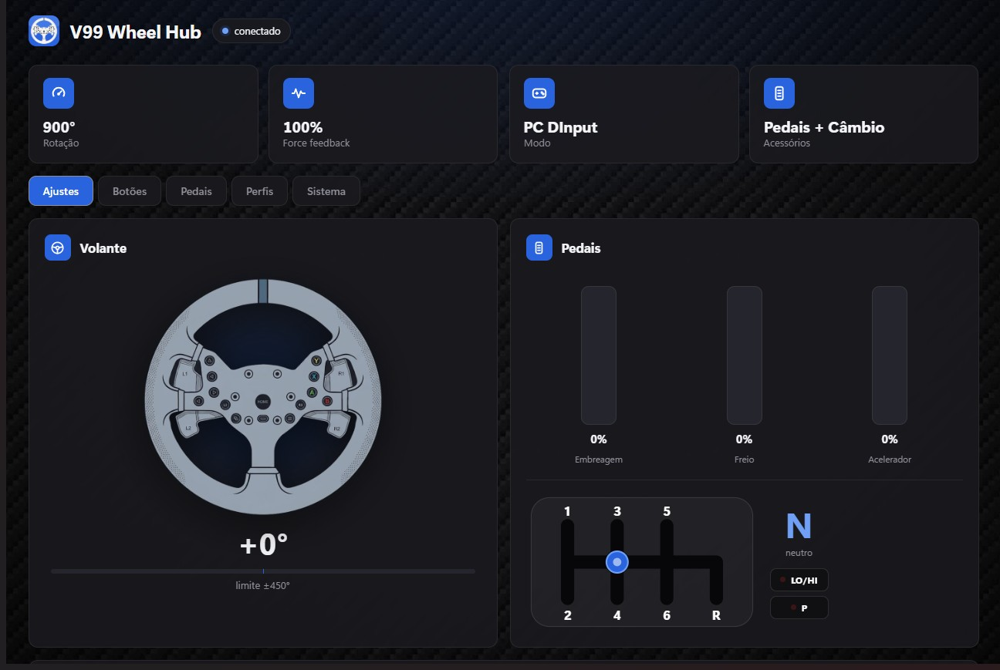
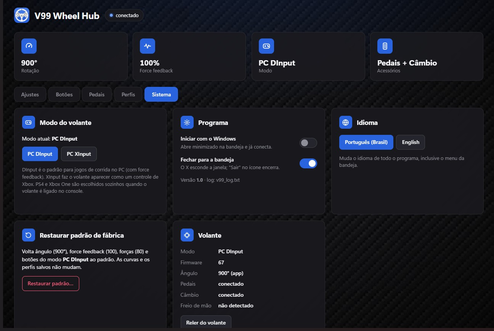

# V99 Wheel Hub

Programa para Windows que configura o volante **PXN V99** pelo Bluetooth, direto do PC — sem precisar do app de celular.

> *English summary below.*

**Versão atual: 1.0**





---

## O que ele faz

- **Leitura ao vivo:** volante girando na tela, pedais, câmbio H com a marcha engatada e botões acendendo sobre a imagem do volante.
- **Ajustes:** ângulo de rotação (90–900°), force feedback, inverter FFB, mola, amortecimento, atrito e inércia. (Apenas leitura virtual, ainda sem trava física no volante.)
- **Mapeamento de botões:** qualquer botão do volante, pedal ou câmbio vira outro botão de controle, uma tecla ou um clique de mouse.
- **Curvas dos pedais:** editor gráfico com 4 pontos para acelerador, freio e embreagem (linear, progressiva, agressiva ou personalizada).
- **Modo do volante:** troca entre PC DInput e PC XInput.
- **Perfis:** salve tudo (ajustes, botões e curvas) com um nome, exporte e importe em arquivo.
- **Perfil automático por jogo:** quando o jogo abre, o perfil dele é aplicado sozinho; quando fecha, volta para o perfil escolhido.
- **Detecção de acessórios:** percebe na hora quando pedais ou câmbio são conectados ou desconectados.
- **Programa de bandeja:** janela própria, ícone na bandeja, iniciar com o Windows e instância única.
- **Leve em segundo plano:** com a janela minimizada ou na bandeja, a leitura ao vivo é desligada e o programa praticamente não usa recursos.
- **Português e inglês**, escolhidos na aba Sistema.
- **Log em inglês** (`v99_log.txt`, ao lado do `.exe`) para diagnosticar problemas.

Tudo o que é gravado fica salvo **no próprio volante** e continua valendo mesmo com o programa fechado.

## Como usar

1. Baixe o `V99 Wheel Hub.exe` na página de *Releases*.
2. Ligue o volante e **feche o app PXN do celular** (o volante aceita só uma conexão Bluetooth por vez).
3. Abra o programa. Ele procura e conecta sozinho.

Requisitos: Windows 10 ou 11 com Bluetooth e WebView2 (já vem no Windows 11).
Na primeira vez o Windows pode mostrar o aviso do SmartScreen, porque o `.exe` não tem assinatura digital: clique em **Mais informações → Executar assim mesmo**.

Os perfis (`perfis_v99.json`), a configuração (`config_v99.json`) e o log ficam na mesma pasta do `.exe`, então o programa é portátil.

---

## Como foi feito

O V99 só tinha app oficial para celular. A ideia inicial era rodar esse app no PC com um emulador de Android, mas emuladores não repassam o Bluetooth do computador. Então o caminho foi entender **como o volante se comunica** e escrever um programa próprio.

1. **Descobrir o tipo de conexão.** O volante usa Bluetooth Low Energy (BLE), com um serviço GATT simples: uma característica para enviar comandos e outra para receber respostas.
2. **Mapear os comandos.** Cada mensagem tem 20 bytes e o primeiro byte diz o tipo. Os comandos de leitura e de gravação foram identificados um a um.
3. **Confirmar tudo no volante real.** Cada comando foi testado com scripts Python pequenos usando a biblioteca **bleak**: leitura do estado, leitura e gravação do perfil, ângulo, força, botões, curvas, modo e reset. Os testes também mostraram detalhes de comportamento (como o volante às vezes ignorar um comando que chega logo após outro), e o programa passou a reenviar e só aceitar uma gravação quando o volante confirma.
4. **Montar o programa.** Um serviço em Python fala com o volante e serve uma interface web local; uma janela própria (WebView2) mostra essa interface, com ícone na bandeja.
5. **USB foi investigado e descartado:** a configuração pelo cabo usa um canal diferente, sem documentação, e testar comandos às cegas ali poderia atingir funções de firmware.

O protocolo está documentado em [`PROTOCOLO_V99.md`](PROTOCOLO_V99.md).

### Arquitetura

| Arquivo | Função |
|---|---|
| `v99_app.py` | Serviço: Bluetooth (bleak), servidor HTTP local em `127.0.0.1:8765`, eventos ao vivo (SSE), API, perfis, configuração, perfil automático por jogo e log |
| `v99_hub.py` | Janela (pywebview/WebView2), ícone na bandeja (pystray), iniciar com o Windows, instância única |
| `app_v99.html` | Interface inteira (HTML, CSS e JavaScript num arquivo só) |
| `v99_idioma.py` | Textos em inglês das mensagens do serviço e da bandeja |
| `v99_ler.py` | Constantes do Bluetooth e um script simples de leitura |
| `assets/` | Ilustração do volante, textura de fibra de carbono e ícone |
| `ferramentas/` | Script que gera o ícone a partir da ilustração do volante |

A API local só aceita pedidos da própria página (cabeçalho `X-V99` e `Host` igual a `127.0.0.1`/`localhost`), para que sites abertos no navegador não consigam mexer no volante.

---

## Desenvolvimento

### Preparar o ambiente

Precisa do **Python 3.12** no Windows.

```bash
pip install -r requirements.txt
```

### Rodar a partir do código

Com janela própria (igual ao `.exe`):

```bash
python v99_hub.py
```

Só o serviço, abrindo no navegador (mostra o log no console):

```bash
python v99_app.py
```

Para testar ao lado do `.exe` já aberto, use outra porta: defina `V99_PORTA=8766` antes de rodar `v99_app.py`.

### Gerar o `.exe`

Feche o programa antes (senão o `.exe` fica travado) e rode na pasta do projeto:

```bash
python -m PyInstaller --noconfirm --clean --onefile --windowed --name "V99 Wheel Hub" --icon "assets\icone.ico" --add-data "app_v99.html;." --add-data "assets\volante.png;assets" --add-data "assets\fibra.jpg;assets" --add-data "assets\icone.png;assets" --add-data "assets\icone.ico;assets" --collect-all bleak --collect-all winrt --collect-all webview --collect-all clr_loader --collect-all pythonnet --hidden-import pystray._win32 --exclude-module numpy v99_hub.py
```

O resultado fica em `dist\V99 Wheel Hub.exe` (cerca de 20 MB).

### Imagens

- `volante.png`: ilustração do volante (sem logotipos), com fundo transparente.
- `fibra.jpg`: textura de fibra de carbono de uso livre.
- `icone.png` / `icone.ico`: gerados a partir da ilustração com `python ferramentas/gerar_icone.py`.

As luzes que acendem sobre os botões usam a tabela `LUZES` de `app_v99.html` (posição de cada botão em % da imagem). Se trocar a ilustração, meça os botões de novo e atualize a tabela.

### Traduções

- Textos da interface: dicionário `EN` no início do script de `app_v99.html`. A chave é o texto em português.
- Mensagens do serviço e da bandeja: dicionário `EN` em `v99_idioma.py`.

Para um texto novo, escreva em português no código (com `t("...")`) e acrescente a tradução no dicionário correspondente.

---

## Limitações conhecidas

- Configuração só por Bluetooth; pelo USB não é possível.
- Só um aparelho conectado por vez: feche o app do celular antes de usar.
- Exportar e importar perfis ainda não foi testado manualmente.
- O freio de mão avulso (acessório separado) não foi testado.

## Licença

Código sob a licença MIT (veja [`LICENSE`](LICENSE)). O software é fornecido "como está", sem garantia.

## Aviso

Projeto independente e não oficial, sem relação com a PXN, que não o criou, não o aprovou e não dá suporte a ele. "PXN" e "V99" são marcas de seus respectivos donos e aparecem aqui apenas para identificar o aparelho compatível. Este repositório não contém software, imagens nem outros materiais da PXN.

Gravar configurações no volante é por sua conta e risco.

---

## English summary

**V99 Wheel Hub** is a Windows app that configures the **PXN V99** racing wheel over Bluetooth Low Energy, replacing the phone-only official app. It shows live wheel, pedal, H-shifter and button input; sets rotation angle, force feedback and spring/damper/friction/inertia forces; remaps buttons; edits pedal curves; switches between DInput and XInput; saves and auto-applies profiles per game; detects accessories being plugged in or out; runs from the tray with live reading turned off in the background; and is available in Portuguese and English, with an English log file.

Every command of the BLE protocol was confirmed on a real wheel; the protocol is documented (in Portuguese) in `PROTOCOLO_V99.md`.

Development: Python 3.12, `pip install -r requirements.txt`, run `python v99_hub.py`, and build the `.exe` with the PyInstaller command above.

Unofficial and independent: not affiliated with, endorsed by or supported by PXN. "PXN" and "V99" are trademarks of their respective owners, used only to name the compatible device. This repository contains no PXN software, images or other material. MIT licensed, provided "as is", use at your own risk.
